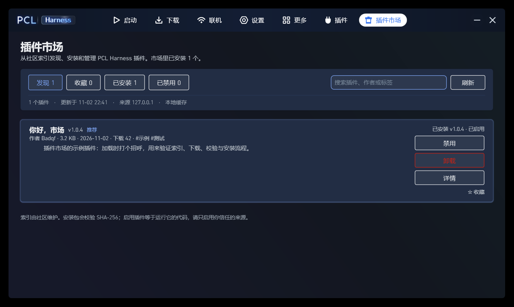

# PCL Harness 插件市场

> 基于目前开发的 PCL-Harness 分离出来的插件商店。
> 一个为 [PCL Harness](https://github.com/Badqf/PCL2) 3.7.3+ 提供插件发现、安装与更新的
> 独立插件。市场本身也是普通插件，不依赖启动器内置商店，不占用启动器版本号。



## 功能

- **索引发现**：从可配置的 JSON 索引读取插件列表，支持搜索、标签展示与精选优先排序；顶部横向分类「发现 / 收藏 / 已安装 / 已禁用」。
- **一键安装 / 更新**：下载 `.pclplugin`，按索引声明的 SHA-256 校验后交给宿主导入；卡片内显示下载进度。
- **市场自更新**：市场从 `update.json` 检查自己的新版本，更新后提示「需要重启以生效」并提供快速重启；不打断其他操作。
- **离线缓存**：索引与安装包缓存在插件自己的 data 目录；断网时回退到上一次索引。
- **镜像回退**：默认按 `ghfast.top` → `gh-proxy.com` → 原地址的顺序尝试；可在设置里关闭。
- **本地管理**：显示已安装版本与启用状态，支持安装、更新、启用、禁用、卸载；分类只统计索引中的插件。
- **下载量**：索引可携带 Release 资产的累计下载量，卡片显示「下载 N」；缺失时不显示，不伪造 0。
- **收藏**：卡片可一键收藏，收藏列表保存在插件自己的 `data/favorites.txt`，不写 `.json`，避免触发起动器热重载。
- **权限边界**：使用 `plugins` 权限调用宿主管理 API；访问未知主机时通过 `net.dynamic`
  弹窗申请，授权记录长期有效并可撤销。

## 安装

要求 **PCL Harness 3.7.3 或更高版本**（插件 API v6），系统为 Windows 10/11，
启动器使用 .NET Framework 4.8。

1. 从 [Releases](https://github.com/Badqf/PCL-Harness-Market/releases) 下载最新的
   `pcl-harness-market-<version>.pclplugin`。
2. 打开启动器 →「插件」→「导入插件…」，选择下载的包。
3. 导入后插件默认未启用，在插件列表里启用「插件市场」。
4. 标题栏出现「插件市场」入口。

也可以手动把 `plugin.json` 与 `PCLHarness.Market.dll` 放进
`PCLHarness\Plugins\pcl-harness-market\`，再在插件页启用。

## 使用

- 顶部搜索框按名称、作者、标签过滤；分类标签横向切换「发现 / 收藏 / 已安装 / 已禁用」。
- 「刷新」立即拉取索引；「详情」展开描述、更新说明与主页链接。
- 安装完成后插件**默认不启用**，需要手动点「启用」——启用等于运行插件代码。
- 更新正在运行的插件时，3.7.4 会把新版本放进待生效队列；完成后按提示点「立即重启」即可加载新版本。3.7.3 需要手动禁用、重启启动器后再更新。
- 市场页只列出索引里的插件；自己导入、或已从索引下架的插件，请到「插件」页管理。
- 市场自身的更新入口在控制卡下方，只有检测到新版本或存在待重启更新时才显示。

### 设置

| 设置 | 默认 | 说明 |
| --- | --- | --- |
| 索引地址 | 本仓库 `main/index.json` 的 raw 地址 | 可填自建镜像或本地开发服务器。 |
| 优先使用镜像 | 开 | 先走 `ghfast.top` / `gh-proxy.com`，失败再直连。 |
| 打开时自动刷新 | 开 | 进入市场时后台更新索引；关闭后只读缓存。 |

设置由宿主自动持久化到 `Plugins\plugins.settings.json`。

## 本地开发

工具链需要 Windows PowerShell 5.1+、Roslyn `vbc.exe` 与 .NET Framework 4.8 参考程序集。
`build.ps1` 会依次查找：

1. `-Launcher` 参数；
2. 环境变量 `PCL_HARNESS_EXE`；
3. 脚本同目录的 `PCL Harness.exe`；
4. `F:\PCL2-Release\PCL Harness.exe`。

参考程序集默认取 NuGet 缓存
`microsoft.netframework.referenceassemblies.net48\1.0.3\build\.NETFramework\v4.8`，
可用 `-ReferencePath` 覆盖。

```powershell
# 编译到仓库根目录的 PCLHarness.Market.dll
powershell -ExecutionPolicy Bypass -File .\build.ps1

# 打包（输出 dist\pcl-harness-market-<version>.pclplugin）
powershell -ExecutionPolicy Bypass -File .\build.ps1 -Pack

# 本地预览索引与安装包（默认 _dev\www，端口 8765）
powershell -ExecutionPolicy Bypass -File .\tools\dev-server.ps1
```

调试时把「索引地址」指向 `http://127.0.0.1:8765/index.json`。首次访问回环地址会触发
`net.dynamic` 授权弹窗，这是宿主的安全机制。

`_dev/` 是本地测试目录，已被 `.gitignore` 排除；可参考
[`docs/PUBLISHING.md`](docs/PUBLISHING.md) 构造一个测试条目。

## 索引与发布插件

索引格式见 [`index/schema.md`](index/schema.md)，插件作者流程见
[`docs/PUBLISHING.md`](docs/PUBLISHING.md)。简短版：

1. 在插件仓库发布 Release，上传 `.pclplugin`，记下稳定下载地址与 SHA-256。
2. 在市场仓库新增 `index/plugins/<id>.json`，填写 `latest`。
3. 运行 `tools\make-index.ps1` 生成根 `index.json`，提交 PR。

## 下载量

发现页暂不显示下载量：当前插件包走仓库直链，GitHub 不提供按文件的下载计数，不能凭空伪造数字。完整方案（一期把包挂到 GitHub Release，由 Action 每天把 `download_count` 烘焙进 `index.json`；二期用 Cloudflare Worker 做趋势）见
[`docs/DOWNLOAD-STATS.md`](docs/DOWNLOAD-STATS.md)。是否启用、是否迁到 Release 待定。

## 目录结构

```
plugin.json              插件清单
MarketPlugin.vb          插件入口：页面、设置、事件、后台任务
MarketPage.vb            市场 UI
MarketClient.vb          索引/包下载、镜像回退、缓存、安装调用
MarketModel.vb           索引模型、JSON 读取、版本比较
build.ps1 / pack.ps1     编译与打包
index.json               生成的根索引（默认拉取地址）
index/schema.md          索引格式说明
index/plugins/           插件条目源文件（每个 <id>.json）
tools/make-index.ps1     校验条目并生成 index.json
tools/dev-server.ps1     本地静态服务器
docs/                    设计、发布说明、截图
```

## 兼容性与已知限制

- 只面向 **PCL Harness 3.7.3+ / API v6**；旧版启动器没有 `plugins` 权限与管理 API。
- **运行中的插件无法热更新/热卸载**：宿主用 `Assembly.LoadFrom` 加载 DLL，文件在进程
  退出前一直被锁定。市场会在 `PluginSummary.Loaded = true` 时直接拦截，并提示先禁用、
  关闭启动器、再更新或卸载。
- 没有回滚、评分、评论、签名验证；索引由仓库维护者审核。
- 镜像由第三方提供，可用性不受本项目控制；摘要校验只保证字节一致，不保证来源可信。
- 索引缓存 10 分钟；强制刷新会重新走网络。

## 许可

插件与仓库内容沿用《PCL 分发有限许可》，见 [LICENSE](LICENSE)。

